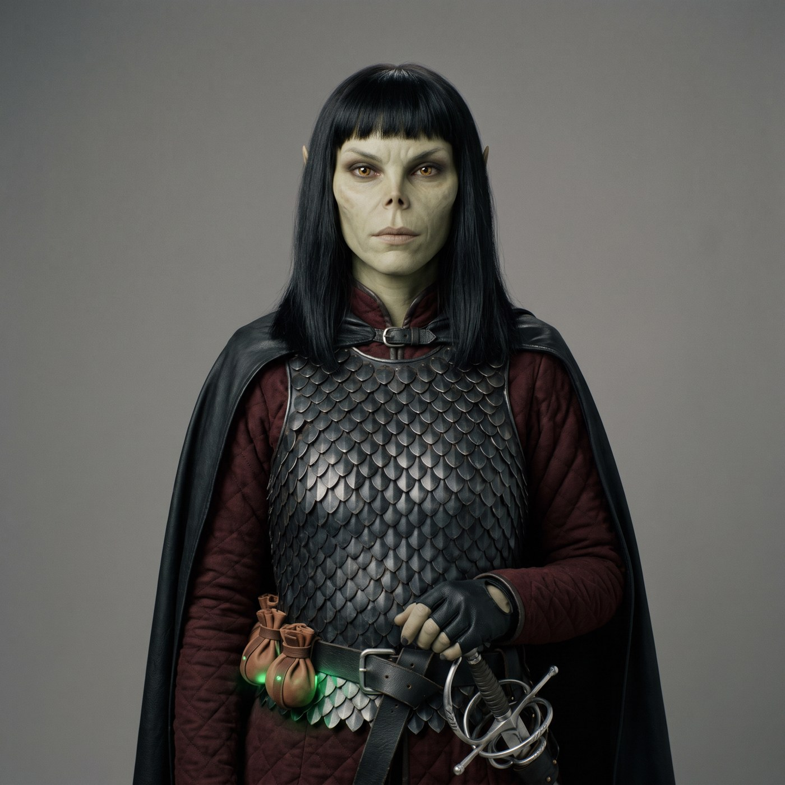
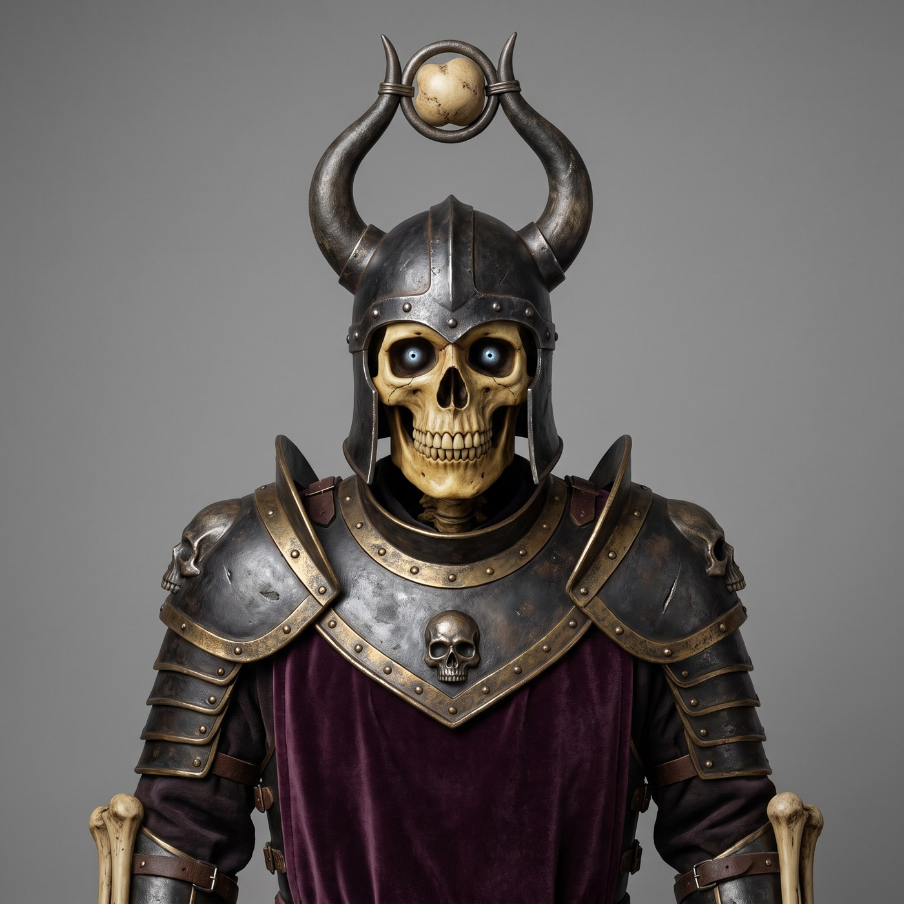
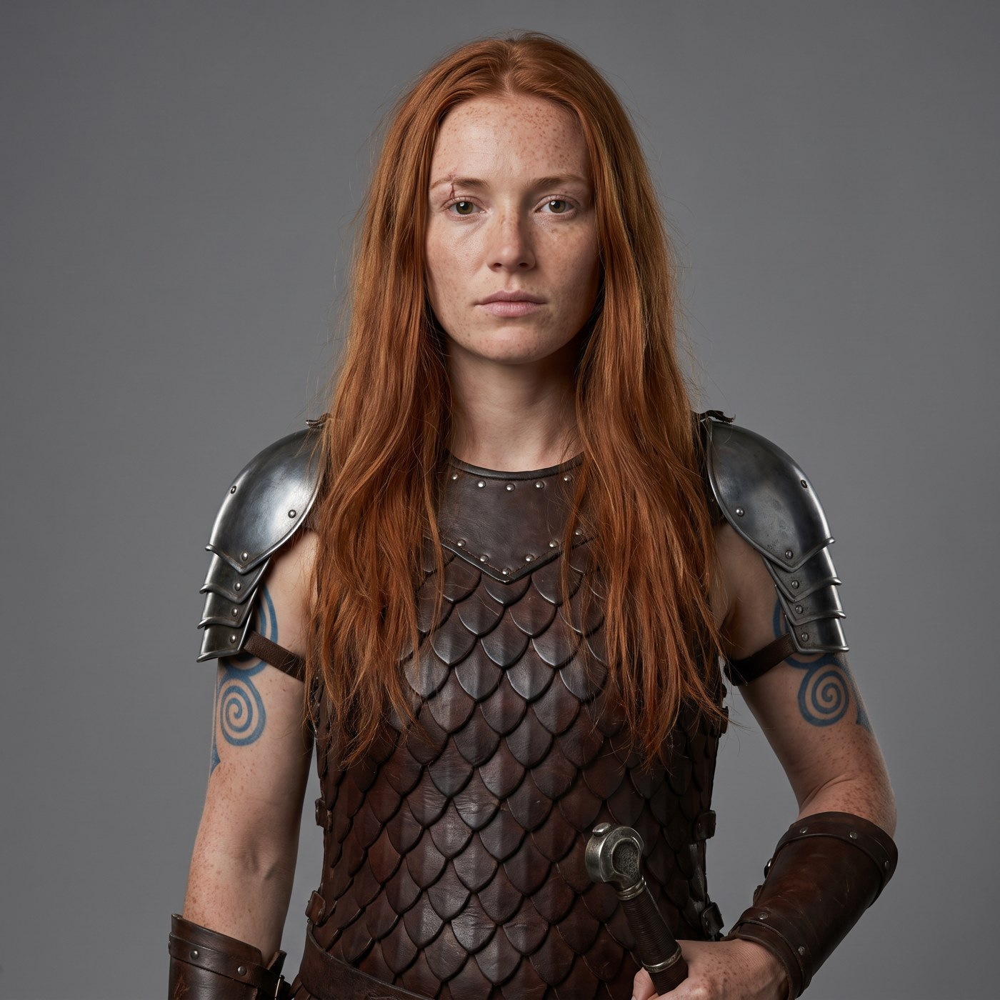
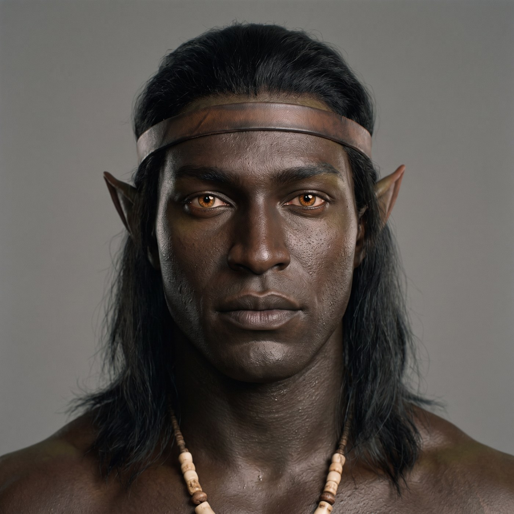
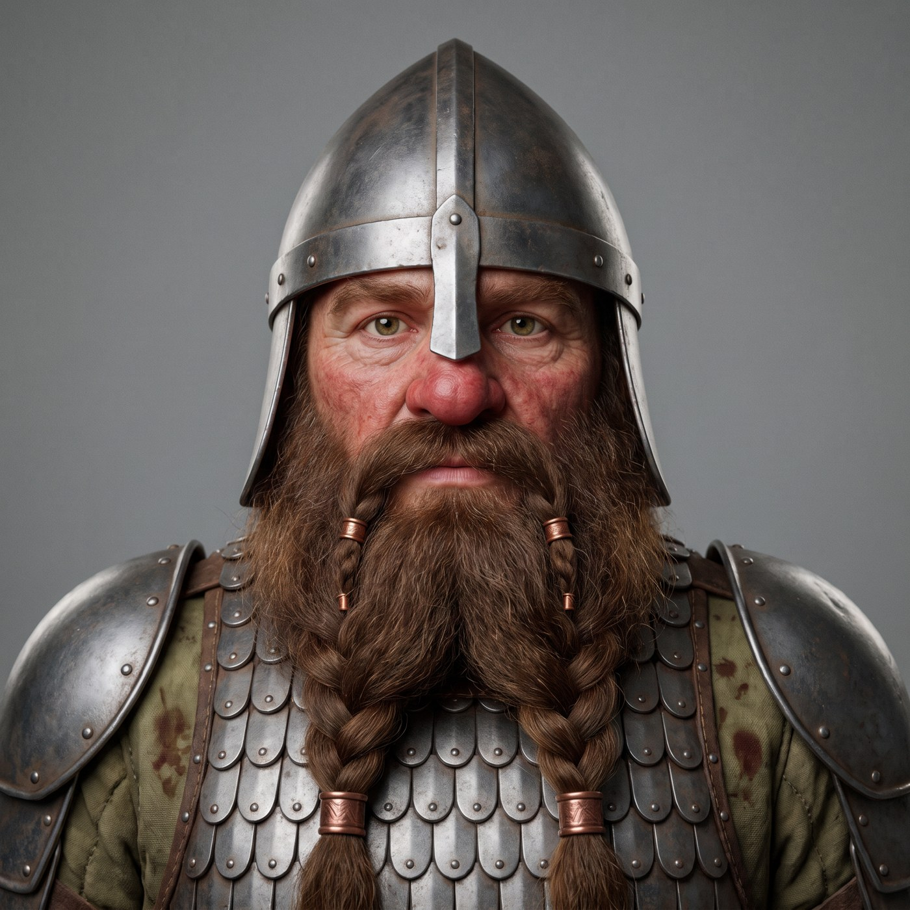
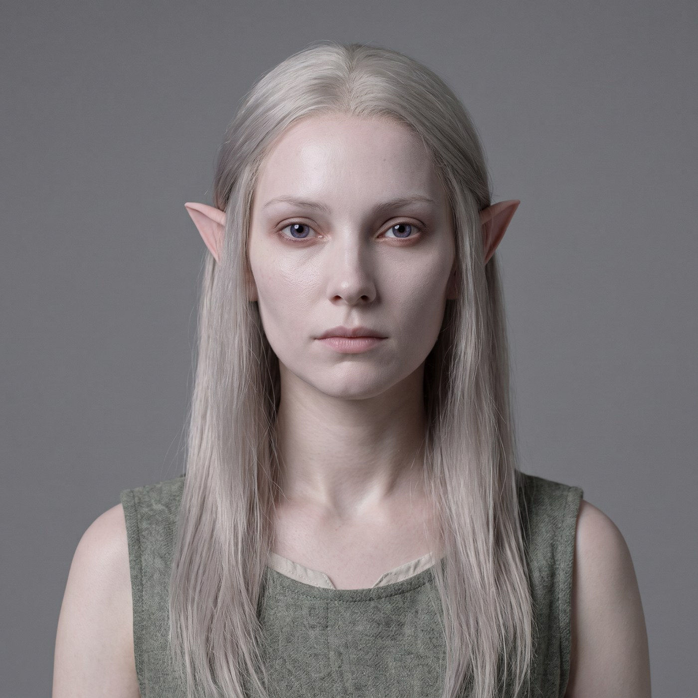
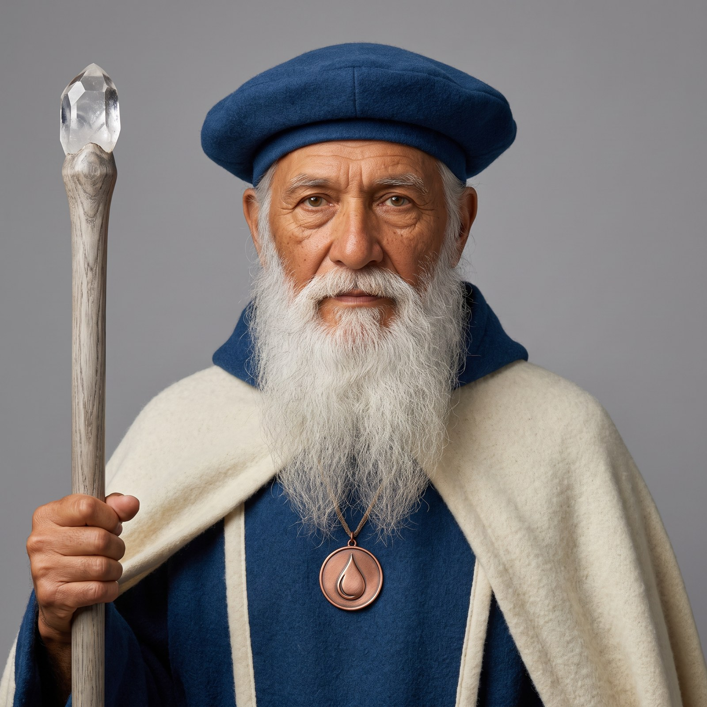
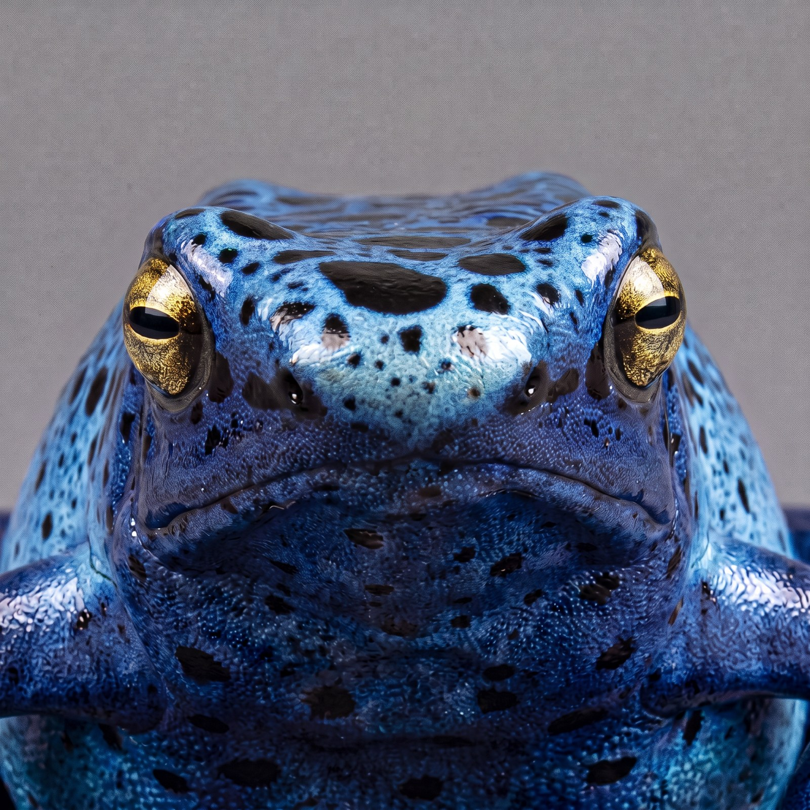
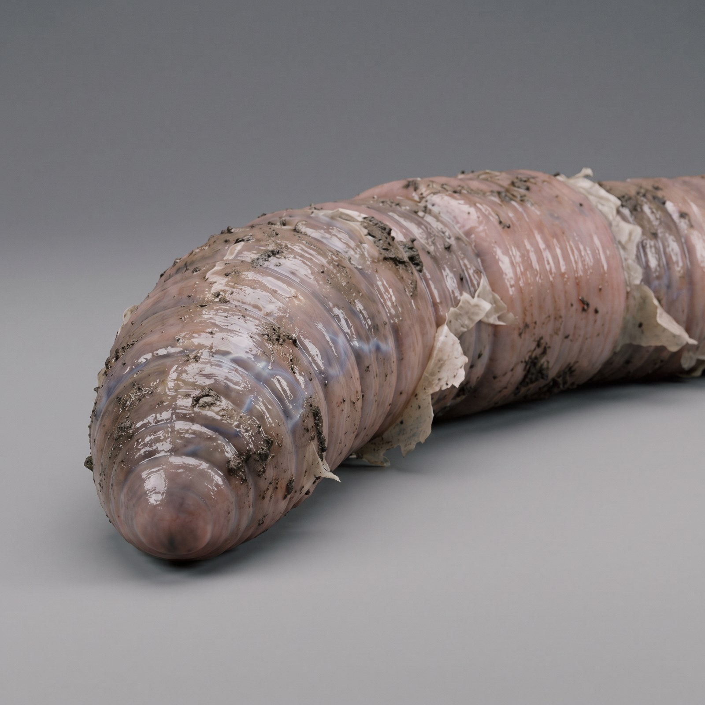

# 02-cast: the seven characters and the two mobs

One folder per character and per mob, in the numbering of the hand-made pack. Each holds the three things that define that character across the film: the **prints** (the photographed 3D-printed mini, the source of silhouette, pose and costume), the **sheet** (the persona sheet written by hand, plus the character sheet panels the agents drew on Nano Banana Pro from those photos) and the **mesh** (the 3D stand-in cast from the rendered turnaround, used on the Blender stage for blocking).

The LOCK BLOCK of every character lives in the continuity bible (`04-prompts/01-CONTINUITY-BIBLE.md`) and is pasted unchanged into every prompt that shows them. The sheet here is the long form of the same facts.

<table><tr><td align="center"><br><sub>Sera'kith Vel</sub></td><td align="center"><br><sub>Mordecai Ashgrave</sub></td><td align="center"><br><sub>Vessa Rowanblood</sub></td><td align="center"><br><sub>Dax Vorrune</sub></td><td align="center"><br><sub>Borrin Hollowcask</sub></td><td align="center"><br><sub>Sylwen Aerindel</sub></td><td align="center"><br><sub>Father Oswin Tallow</sub></td><td align="center"><br><sub>the frogs and toads</sub></td><td align="center"><br><sub>the earthworm</sub></td></tr></table>

| folder | pack number | who | role in the story |
| --- | --- | --- | --- |
| [`ch1-vessa/`](ch1-vessa/) | Character 1 | Vessa Rowanblood | barbarian woman, red hair, heater shield on the left arm, greatsword Gryma broken at the tip; the rear guard |
| [`ch2-borrin/`](ch2-borrin/) | Character 2 | Borrin Hollowcask | dwarf, conical nasal helmet, long bearded axe with the lantern hung under its head, pewter flask; says the last line |
| [`ch3-dax/`](ch3-dax/) | Character 3 | Dax Vorrune | half-githyanki barbarian, sword Halfblade broken through the middle and held in both hands, fur boots; jumps and slips |
| [`ch4-sylwen/`](ch4-sylwen/) | Character 4 | Sylwen Aerindel | elf healer, gown, barefoot, carries nothing; caught in the worm's coil in scene 3 and heals from inside it |
| [`ch5-oswin/`](ch5-oswin/) | Character 5 | Father Oswin Tallow | old bearded human priest, crystal staff with a clear faceted crystal, water magic that does nothing to amphibians |
| [`ch6-vel/`](ch6-vel/) | Character 6 | Sera'kith Vel | githyanki leader and the lead of the film; silvered rapier Needle with a swept black hilt, six acid pots on the belt, cloak |
| [`ch7-mordecai/`](ch7-mordecai/) | Character 7 | Mordecai Ashgrave | undead necromancer, skull face, horned helmet; no weapon, casts acid-green flame from his hands; her rival for strongest |
| [`mob1-frogs/`](mob1-frogs/) | Mob 1 | Poisonous frogs and toads | the swarm: blue, yellow, orange, violet and lime frogs over warty olive toads; the pink PLA prints stand in for them |
| [`mob2-worm/`](mob2-worm/) | Mob 2 | The giant earthworm | coiled round a rubble mound in the roofless hall; the articulated print is its stand-in (its round eye marks the mouth end, its cowl the swollen collar, its shed plates the sloughed skin) |
| [`all-together/`](all-together/) | group photos | the seven minis side by side (IMG_8206 to IMG_8211) | relative heights and the party's silhouette |
| [`size-from-afar/`](size-from-afar/) | scale photos | the minis seen from a distance (IMG_8212 to IMG_8215) | how small the party reads against the sets |

Each character folder:

```
chN-name/
  README.md          who they are, which photos and panels are theirs, status
  prints/            the four turnaround photos of the mini (front, left, back, right), as shot on the phone
  sheet/             the persona sheet (.md) and the drawn panels (face-front, face-profile, face-three-quarter, front, left, back, right, outfit-main, and for the five who speak most: anger, fear, joy, hands, prop) plus sheet.png, the rendered page
  mesh/              the cast .glb and its turntable clip
```

The panels are 2K PNGs of 7 to 9 MB each (about 1.1 GB for all nine sheets with their rejected takes). See the README's note on large files: the picked panels come here; every take, including the rejected ones, stays in `08-making-of/` and on Drive.

**Where the files are:** what is committed is in this folder; everything else is in the [Drive folder](https://drive.google.com/drive/folders/1kCBG05_lyew2FaTS4ctl32E2DqXj1o6B) under `02-cast/`, which mirrors these folders. Nothing here points at a private machine.

Also on Drive only, as whole folders: `source-sheets/` (the hand-made character folders exactly as they are, with every subfolder) and `storyboard-sheets/` (the storyboard's per-character sheet index files).
