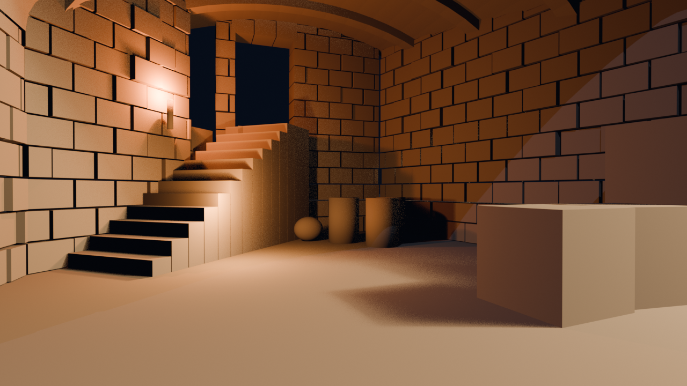

# Scene 1: the storeroom under the stairs

A vaulted cellar, 8 m by 6 m, the worn staircase along the right wall climbing to a dark doorway, three iron-banded barrels, crates and sacks; the dwarf's lantern is the only light.

**What goes here**

- `environment.md`: `Scene 1 - Environment.md` from the prompt pack
- `build-photos/`: 30 photos of the clay build
- `action-maps/`: 18 action maps drawn over the build photos
- `stage/`: Blender window captures, the top view beside the build photo, the master-view render, the turntable, the stage scripts
- `plates/`: `lo-storeroom-1.png`, `lo-storeroom-2.png`, their layout overlays and the prompts that drew them

**Where the files are:** what is committed is in this folder; everything else is in the [Drive folder](https://drive.google.com/drive/folders/19oNrUVefdrb2mwJs_GR5v11iavYkja07) under `03-locations/scene-1-storeroom/`, which mirrors these folders. Nothing here points at a private machine.

**Status:** environment, stage renders, turntable, plates and the layout overlays are here; the build photos and action maps go to Drive (phone photos, 1 to 20 MB each) with the contact sheet here.

*The layout overlay of the first plate: where the agents placed the build's walls, stairs and props before drawing it.*
