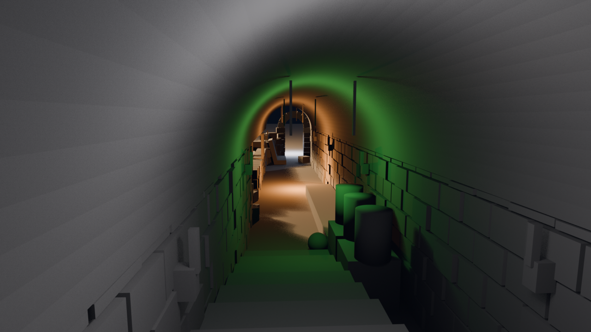

# Scene 2: the flooded corridor

A 30 m vaulted corridor from the top of the stairs to a cold grey archway, ankle-deep water, a niche, a slab, a crate and barrel near the far end.

**What goes here**

- `environment.md`: `Scene 2 - Environment.md` from the prompt pack
- `build-photos/`: 15 photos of the clay build
- `action-maps/`: 13 action maps drawn over the build photos
- `stage/`: Blender window captures, the top view beside the build photo, the master-view render, the turntable, the stage scripts
- `plates/`: `lo-corridor-1.png`, `lo-corridor-2.png`, their layout overlays and the prompts that drew them

**Where the files are:** what is committed is in this folder; everything else is in the [Drive folder](https://drive.google.com/drive/folders/1FWxTWA6g5YAU0IvnW3phteEQP4Db5o-Y) under `03-locations/scene-2-corridor/`, which mirrors these folders. Nothing here points at a private machine.

**Status:** environment, stage renders, turntable, plates and the layout overlays are here; the build photos and action maps go to Drive (phone photos, 1 to 20 MB each) with the contact sheet here.

*The layout overlay of the first plate: where the agents placed the build's walls, stairs and props before drawing it.*
