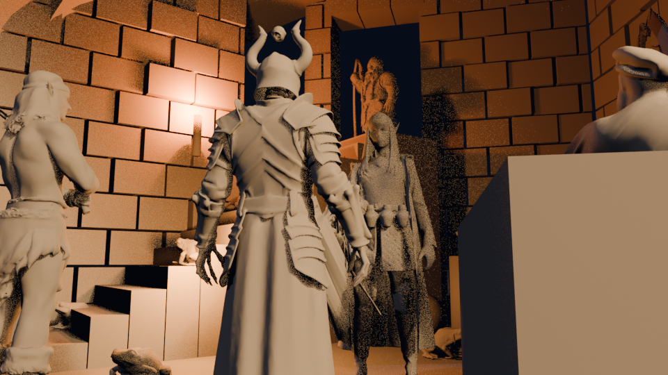

# 1C-2: Company: the room erupts (behind Mordecai and Oswin)

Scene 1. Storyboard shot 1D. WS, low angle, handheld, 28 mm, 3.5 s.

**In this folder**

- `clay/clay.mp4`: the blocking clip from the Blender stage, the locked camera and motion guide
- `clay/first-frame.png`: its first frame, the layout reference every frame and clip was drawn from
- `clay/cameras.json`: the camera path
- `takes/1C-2-take-1.mp4`
- `takes/1C-2-v2.mp4`
- `takes/1C-2-v3.mp4`
- `pick.mp4`: the take that went into the cut
- `compare/`: comparison strips, where the shot was filmed again

**Elsewhere**

- the 4K finish of the cut this take sits in: [`07-cut/`](../../07-cut/), and the [Drive folder](https://drive.google.com/drive/folders/1FWxTWA6g5YAU0IvnW3phteEQP4Db5o-Y) under `07-cut/`
- the prompt as sent: pending the copy into `prompt.txt` (its text follows the shape in [`04-prompts/`](../../04-prompts/))
