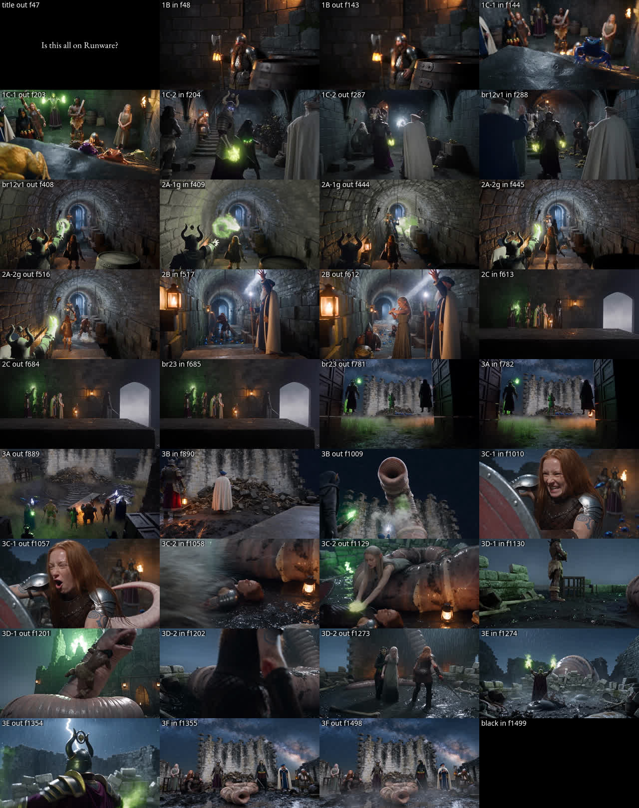

# 07-cut/clean: the clean cut

The film is finished. **The final version is the handheld CRT finish with the mild shake**, `is-this-all-on-runware-crt-4k.mp4`, made at 17:02 UTC on 19 November 2026 from the clean cut below.

| file | what | size | where |
| --- | --- | --- | --- |
| `is-this-all-on-runware-crt-4k.mp4` | **the final film**: the clean cut with a mild handheld shake and the CRT look, 3840x2160, 24 fps, 63.958 s | 360 MB | Drive under `07-cut/clean/`, and the GitHub release |
| `is-this-all-on-runware-crt-1080p.mp4` | the final film at 1080p, as rendered | 114 MB | Drive under `07-cut/clean/`, and the GitHub release (over GitHub's 100 MB file limit) |
| [`is-this-all-on-runware-crt-1080p-github.mp4`](is-this-all-on-runware-crt-1080p-github.mp4) | the same 1080p finish re-encoded at 11 Mb/s so it fits in Git and can be watched here | 90 MB | here |
| `is-this-all-on-runware-clean-4k.mp4` | the clean cut at 4K, before the shake and the CRT look | 395 MB | Drive under `07-cut/clean/` |
| [`is-this-all-on-runware-clean-1080p.mp4`](is-this-all-on-runware-clean-1080p.mp4) | the clean cut at 1080p: 63.958 s, 24 fps, -14 LUFS, title first and 1.5 s of black at the end | 82 MB | here |
| [`checks/check-crt.jpg`](checks/check-crt.jpg) | the check sheet of the CRT look | | here |

The clean cut is the base of the finish: every trim, grade and loudness decision is in [`cuts.md`](cuts.md).

| | |
| --- | --- |
| [`cuts.md`](cuts.md) | the cut's record: what changed from v3 and why, every piece with its in and out, the loudness work, the grade on 2A-1 and 2A-2, the joins, the known flaws kept |
| [`pieces/`](pieces/) | the 19 pieces in order, each rendered on its own (title, 17 shot and bridge pieces, black); the film is their concatenation |
| [`grade-scripts/`](grade-scripts/) | the Python and shell that graded 2A-1, 2A-2 and the tail of bridge-1-2-v1, cut and loudness-matched every piece, and the measurements they wrote |
| [`checks/`](checks/) | the four check sheets the agents looked at: the grade against 2B, the bridge tail, both sides of all 18 joins, and the CRT look |

No retake and no paid call went into this cut: ffmpeg and Python only, on the takes already in [`05-shots/`](../../05-shots/).

**Where the files are:** everything in this folder is committed except the two 4K files and the 114 MB 1080p render, which are in the [Drive folder](https://drive.google.com/drive/folders/1FWxTWA6g5YAU0IvnW3phteEQP4Db5o-Y) under `07-cut/clean/` and on the GitHub release. Nothing here points at a private machine.
