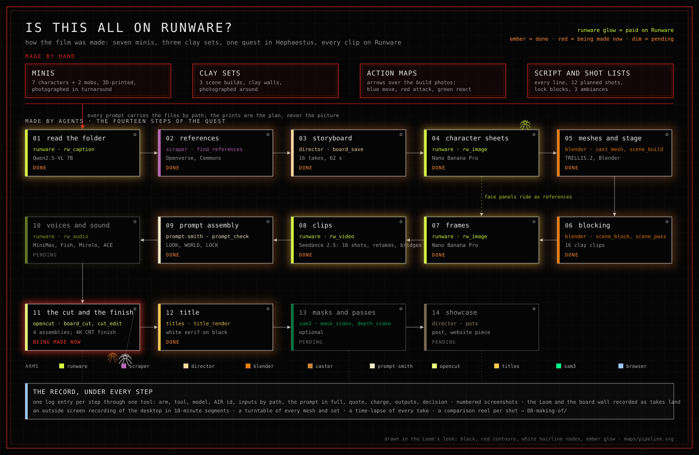

  

# Is this all on Runware?

A 60-second hyper-realistic fantasy short, made for the Runware creative engineer assessment. Seven 3D-printed character minis, two mob prints and three clay-walled sets were built and photographed by hand; everything after that was made by agents running on Runware, through one API, and recorded as it happened.

This repository is the home of the whole project: the hand-made inputs, the logic (the prompts, the continuity rules, the pipeline, the tools), the generated assets, the film, and the record of how it was made. The production is still running as this is written (19 November 2026): the folders are in place, each says what it holds and where it comes from, and the files arrive as the steps finish. Anything marked **pending** has not been made yet.

| | |
| --- | --- |
| film | 60 s plus a 1.5 s fade and a 2 s title, 16:9, 24 fps, 4K |
| story | a party of seven, deep in a dungeon under a fallen castle, low on food, finds the frogs that flood their storeroom were running from something; the last line is the title |
| scenes | the storeroom under the stairs (15 s), the flooded corridor (15 s), the roofless hall under the stars (30 s) |
| shots | 16 takes on the storyboard, 62 s on screen |
| cast | Sera'kith Vel (githyanki leader, the lead), Mordecai Ashgrave (undead necromancer), Vessa Rowanblood and Dax Vorrune (barbarians), Borrin Hollowcask (dwarf), Sylwen Aerindel (elf healer), Father Oswin Tallow (priest); a swarm of poisonous frogs and toads; a giant earthworm |
| made with | agents in [Hephaestus](https://hephaestus.agency), through its Runware arm and the Titanium studio on Runware; Blender for the stages; a 3D printer, air-dry clay and a phone for the inputs |
| models on Runware | Nano Banana Pro for every panel, plate and frame; Seedance 2.5 at 4K for every clip; Qwen2.5-VL for captions; MiniMax Speech 2.8 and Fish S2.1 Pro for voices; Mirelo SFX 1.5 and ACE-Step for sound; Topaz Proteus held as the 4K fall-back |
| budget | an approved ceiling of $177.91 on Runware, split per scene; spend so far is in [`08-making-of/`](08-making-of/) |

## How it was made, in one paragraph

The minis are the *plan* of each shot, never the picture: their silhouette, pose, costume pieces and weapon shapes went into character sheets, their photographs rode as references on every panel, and the clay sets became Blender stages where every shot was blocked with a camera before anything was paid for. The "action maps" drawn over the build photos (blue arrows are movement and sound, red are attacks, green are a character's reaction) decided the shots where the hand-written shot lists and the maps disagreed. From there each shot went the same way: the clay blocking clip gave the layout, the character panels gave the faces, the location plate gave the place, Nano Banana Pro drew the first frame, and Seedance 2.5 filmed the clip from that frame with the assembled prompt, the characters' lock blocks and their face panels as references. Every step, free or paid, was logged with its prompt, its inputs, its quote and its charge, its screenshots and its clips. The maps in [`maps/`](maps/) draw all of this.

## The folders

Numbered in the order the work happened. Each folder has its own README saying what it holds, which file on the production machine it comes from, and whether it is made yet.

| folder | what it is | holds |
| --- | --- | --- |
| [`00-brief/`](00-brief/) | the assessment | the brief in three lines and the PDF |
| [`01-story/`](01-story/) | what the film tells | the script (Markdown and Fountain), the storyboard's shot list, the storyboard file, the three ambiances, the hand-written direction per scene |
| [`02-cast/`](02-cast/) | the seven characters and the two mobs | per character: the print photos, the persona sheet and the drawn panels, the cast mesh |
| [`03-locations/`](03-locations/) | the three sets | per scene: the environment block, the build photos, the action maps, the Blender stage, the location plates; the stage axes |
| [`04-prompts/`](04-prompts/) | the logic | the master prompt, the continuity bible, the asset paths, every prompt as sent per shot and per plate, the sheet facts |
| [`05-shots/`](05-shots/) | one folder per shot | the clay blocking clip and passes, the frame takes and the approved frame, the clip takes and the pick, the prompt |
| [`06-sound/`](06-sound/) | voices, foley and music | every line in its character's voice, every cue, the music bed |
| [`07-cut/`](07-cut/) | the film | the 4K master, the 1080p copy, the title card, the picks in order, the time-lapse and the comparison reel |
| [`08-making-of/`](08-making-of/) | the record | the step log, the numbered screenshots and clips, the screen recordings, the working notes, the references, the tools |
| [`09-showcase/`](09-showcase/) | what goes out | the social post, the website piece, the walkthrough recording |
| [`10-b-roll/`](10-b-roll/) | the build on camera | printing, sculpting, painting and building, as filmed on a phone |
| [`maps/`](maps/) | how it all worked | the pipeline map, the studio map, the per-shot data flow, the agents, the folder map |
| [`tools/`](tools/) | this repository's own tools | the path map from the production machine to these folders, and the script that gathers the files |

How this maps to the production machine: the hand-made pack lives in one folder (`Runware Test/`, with its `Original Prompt/` and `Creative Task Runware/`) and the agents' output in another (the storyboard folder with its `making-of/`). This repository merges the two by subject rather than by who made them, so a character's prints, sheet and mesh sit together, and a shot's clay clip, frame and takes sit together. [`tools/paths.json`](tools/paths.json) is the exact mapping, and [`tools/gather.mjs`](tools/gather.mjs) copies along it.

## The pipeline, step by step

The quest followed fourteen steps, each on a named arm of Hephaestus and a pinned model on Runware. Nothing paid was sent before it was quoted and approved.

| step | what | arm and tool | model | state |
| --- | --- | --- | --- | --- |
| 1 | read the folder: every print, build photo and action map opened and captioned beside the hand-written notes | Runware `rw_caption` | Qwen2.5-VL 7B | done |
| 2 | references: openly licensed pictures of wet masonry, crypt stairs, roofless halls under stars, dart frogs, cane toads, earthworm skin, the weapons | scraper `find_references`, `grab_media` | Openverse, Wikimedia Commons | done |
| 3 | storyboard: logline, characters, mobs, locations and props declared once; the Fountain script; every shot with size, angle, move, lens, cast, dialogue, sound and continuity | director `board_save`, `film_grammar` | | done, approved |
| 4 | character sheets: the facts per character, then the panels drawn with the four print photos as references and the lock block as the prompt, then the sheet rendered | director `sheet_build`, `sheet_render`; Runware `rw_image`; prompt smith `prompt_check` | Nano Banana Pro (`google:4@2`) | done |
| 5 | 3D counterparts and the stage: a mesh per character and mob from the rendered turnaround, each location built as a Blender stage in the frame of its build photos, turntables, the location plates | caster `cast_mesh`; Blender `scene_build`, `scene_place`, `scene_render`; Runware `rw_image` | TRELLIS.2; Nano Banana Pro | in progress |
| 6 | blocking: every shot blocked on its stage with the cast at the positions and facings the action maps give; the clay clip is the locked camera and motion guide | Blender `scene_block`, `scene_pass` | | next |
| 7 | frames: the first frame of every shot, from the clay first frame, the face panels, the plate and the prompt; locked on approval | Runware `rw_image`; `prompt_check` | Nano Banana Pro | pending |
| 8 | clips: every shot filmed from its approved frame, with the face panels as references and the assembled prompt verbatim; 1A at 4K first, as the proof | Runware `rw_models`, `rw_video` | Seedance 2.5 (`bytedance:seedance@2.5`) at 4K | pending |
| 9 | prompt assembly: LOOK, WORLD, SCENE, location, every lock block with its state line and tags, the shot body, the hold line | prompt smith | | written |
| 10 | voices and sound: every line in its voice, the frogs' chorus, the worm's scream, rain, lantern and steel, a 60 s low-string bed | Runware `rw_audio` | MiniMax Speech 2.8, Fish S2.1 Pro, Mirelo SFX 1.5, ACE-Step | pending |
| 11 | the cut: shots in order, lines under their shots, cues, the rain building, a hard smash cut, a 1.5 s hold on black | director `board_attach`, `board_cut`; OpenCut `cut_edit` | | pending |
| 12 | title: "Is this all on Runware?", white serif on black, 2 s | titles `title_render` | | pending |
| 13 | masks and passes where a sky needs replacing or a worm shot a relight (optional) | SAM 3 `mask_video`, `depth_video` | | pending |
| 14 | the showcase: a builder's post and a website piece drafted from the log | director | | pending |

Beside the steps, the record: a log entry for every step through one tool, screenshots through the browser arm, recordings of the Loom and the storyboard editor while the clips land, a turntable of every mesh and location, a time-lapse and a comparison reel at the end. The spec is section 6 of the [master prompt](04-prompts/00-MASTER-PROMPT.md); the result is [`08-making-of/`](08-making-of/).

## Continuity: the rule above all rules

- A character's **LOCK BLOCK** from the bible is pasted unchanged into every image and video prompt that shows them; never paraphrased, never shortened, never passed through a prompt enhancer.
- Their **face-front and front-turnaround panels** ride as references on every frame and every clip they appear in.
- **Weapons never change**: Vessa's greatsword is broken at the top third and her shield is on her left arm; Dax's sword is broken through the middle and held in both hands; Vel's rapier is silvered with a swept black hilt; Borrin's lantern hangs under his axe head; Mordecai has no weapon and casts green flame from his hands; Oswin's staff carries a clear faceted crystal; Sylwen carries nothing.
- **Wounds, mud and rain accumulate** and never reset: the bible's state ladder says what each character looks like at each shot.
- **One pinned model per job**, never the Model Router, and the same seed on a shot's retakes where the schema allows one.
- A **prompt check** before every paid call and after every render; a failed rule means a reshoot, not a new prompt.

## Where the big files live

GitHub keeps a single file under 100 MB and a repository comfortably under a few GB. This project will not fit in plain Git: the 4K takes are tens of MB each, the sheet panels are 7 to 9 MB each (about 1.1 GB with every rejected take), the screen recordings are 85 MB per ten minutes, and the phone footage of the build is about 900 MB. So:

- **In Git, as plain files**: everything that is text, every picked panel, plate and frame, the posters and thumbnails, the log, the screenshots, the prompts and the tools. This is the part you can read on GitHub.
- **In Git through Git LFS** (the recommended path, see below): the picked take of every shot, the 1080p copy of the film, the meshes, the turntables and the process clips. Pointers in Git, the files on GitHub's large-file store, downloaded on demand.
- **On Google Drive, mirrored in the same folder layout**: everything, including what Git never takes: the 4K master, every take including the rejected ones, every screen recording, the full-resolution phone footage. The Drive folder is the backup and the place to watch the big files without cloning: [Is this all on Runware? on Google Drive](https://drive.google.com/drive/folders/1FWxTWA6g5YAU0IvnW3phteEQP4Db5o-Y).

Each folder's README says which of its files are on Drive only. The 4K master also goes on a GitHub Release as an asset, so the film itself can be downloaded from the repository's page without Drive.

**Why Git LFS and not releases alone**: a release holds files, not folders; LFS keeps the picks and clips in the folder structure next to their prompts and logs, where someone reading the making-of expects them. **What it costs**: GitHub gives a free quota of LFS storage and bandwidth per month (10 GB of each at the time of writing, with paid data packs above it); the picks, clips and meshes of this project come to about 1 to 2 GB, so the free quota holds them, but every full clone downloads them again. This is a decision for the owner, not one made here; `.gitattributes` carries the LFS patterns commented out until it is made.

## Reading the record

Start with [`08-making-of/`](08-making-of/): the log is one entry per step, with the prompt in full, the inputs by path, what was quoted and what was charged, what was approved or rejected and why, and the numbers of the screenshots and clips that show it. Then [`maps/`](maps/) for the shape of the whole, [`04-prompts/`](04-prompts/) for the words, and [`05-shots/`](05-shots/) for any one shot from its clay clip to its pick.

## Who made what

The minis, the sets, the action maps, the script, the shot lists, the character and mob sheets, the prompt pack and every approval are Felipe's. The storyboard, the captions, the references, the sheet panels, the meshes, the stages, the blocking, the frames, the clips, the sound, the cut and the record are the agents', working in Hephaestus on Runware under the master prompt. The agents were free to change a shot, a prompt, a tool or a step where another way worked better, and had to keep three things fixed: the story and its ending, each character's identity, and the honesty of the log.

No key, token or account detail is written anywhere in this repository; the runtime reads them from a sealed vault, and the log entries name the model and the price, never the key.
