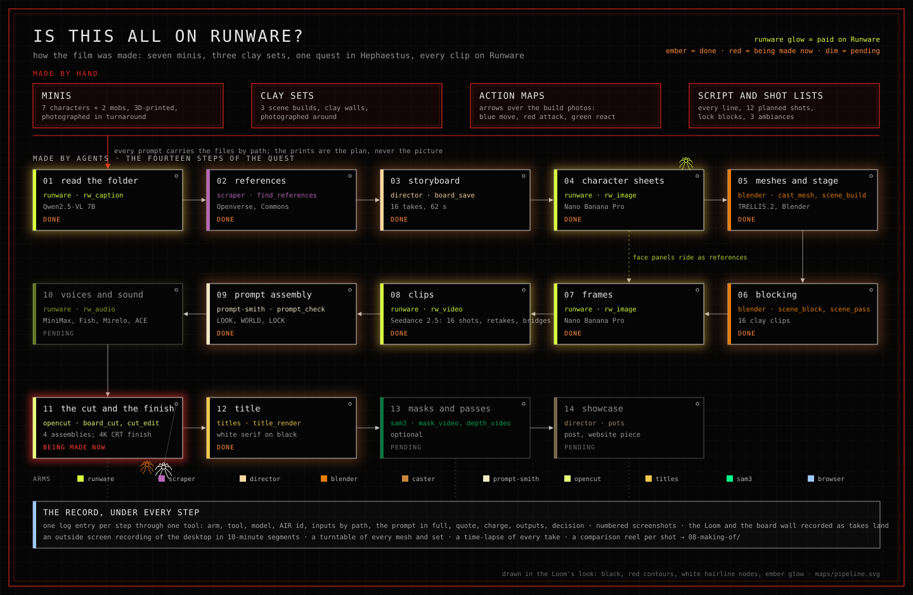
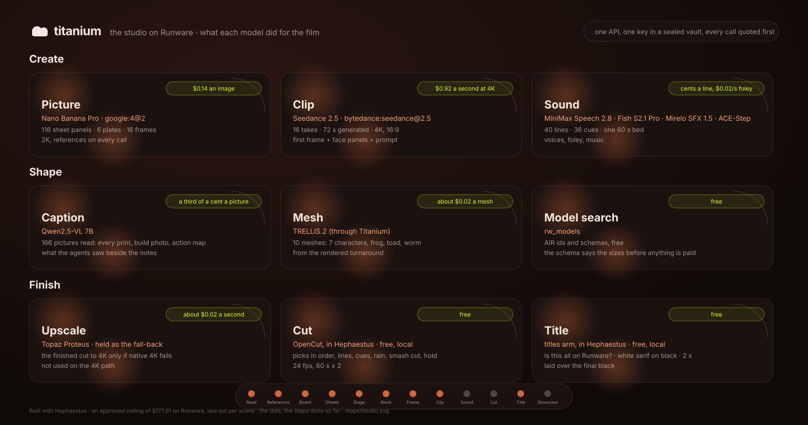

# maps: how it all worked

| map | what it shows | look |
| --- | --- | --- |
| [`pipeline.svg`](pipeline.svg) | the whole: the hand-made inputs, the fourteen steps of the quest with their arm, tool and model, what is done and what is pending, and the record under every step | the Loom's: black, red contours, white hairline nodes, ember glow for what is done, yellow-green for what Runware made |
| [`studio.svg`](studio.svg) | the studio on Runware: what each model did for the film, how many of each thing, and what it costs | Titanium's: warm dark, copper, rounded cards |
| [`pipeline.md`](pipeline.md) | the same in Mermaid, rendered by GitHub: the pipeline, one shot's data flow from build photo to pick, the agents and their lanes, and the folder map | |

**Where the files are:** what is committed is in this folder; everything else is in the [Drive folder](https://drive.google.com/drive/folders/1FWxTWA6g5YAU0IvnW3phteEQP4Db5o-Y) under `maps/`, which mirrors these folders. Nothing here points at a private machine.
