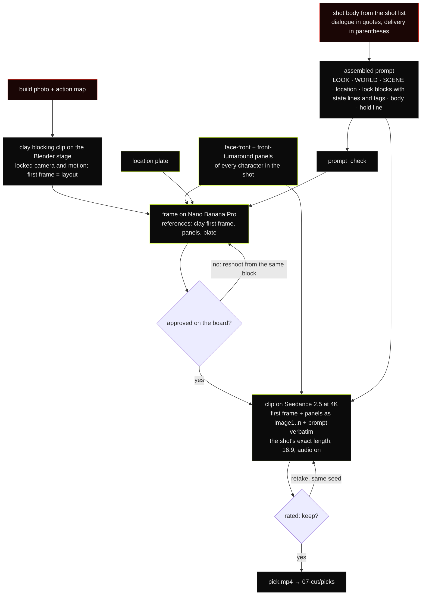
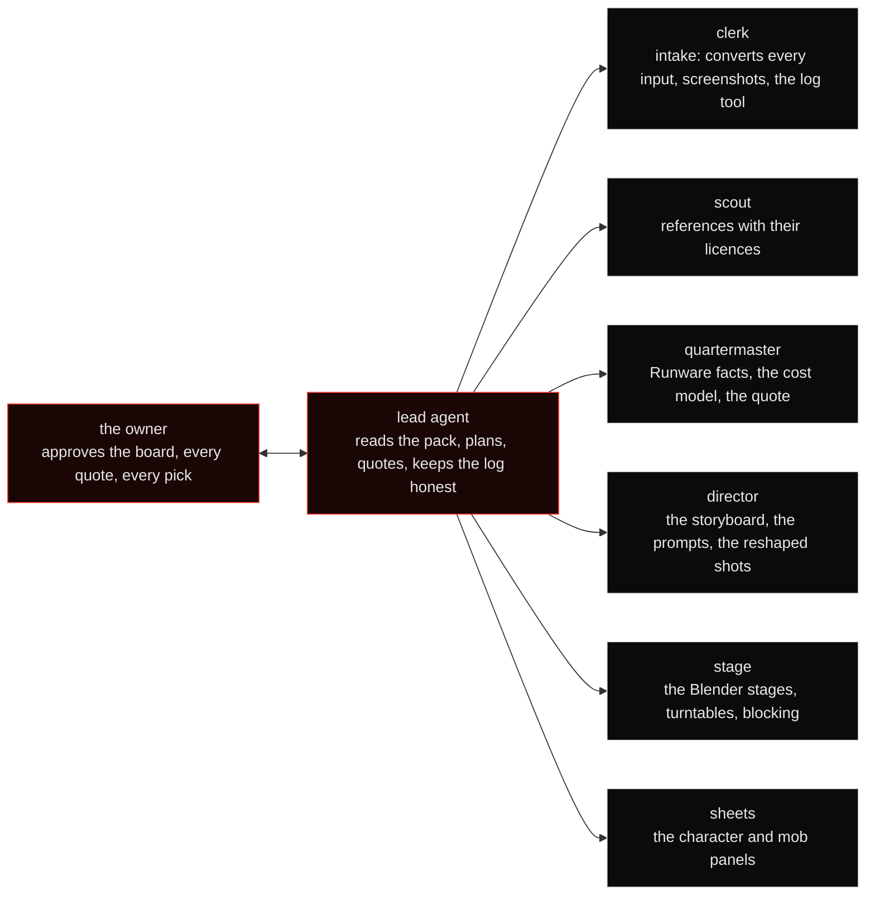
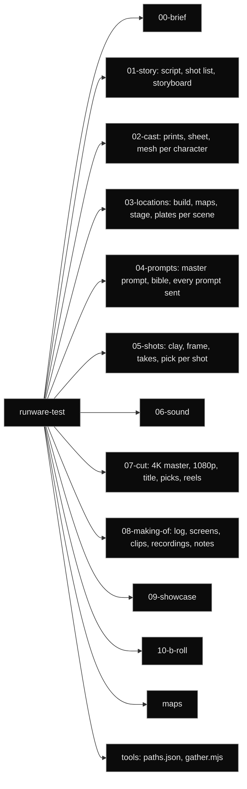

# The pipeline, in Mermaid

GitHub renders these. The drawn versions are [`pipeline.svg`](pipeline.svg) and [`studio.svg`](studio.svg).

## From clay to cut

```mermaid
flowchart LR
  classDef hand fill:#1a0605,stroke:#d8261c,color:#e8e8e8
  classDef rw fill:#0b0b0b,stroke:#d8ff3d,color:#e8e8e8
  classDef free fill:#0b0b0b,stroke:#8a8a8a,color:#e8e8e8
  classDef rec fill:#0b0b0b,stroke:#9ec9ff,color:#e8e8e8

  subgraph hand[made by hand]
    minis[7 minis + 2 mobs<br/>photographed in turnaround]:::hand
    sets[3 clay sets<br/>photographed around]:::hand
    maps[action maps<br/>blue move, red attack, green react]:::hand
    script[script, shot lists,<br/>lock blocks, ambiances]:::hand
  end

  read[1 read + caption<br/>rw_caption, Qwen2.5-VL]:::rw
  refs[2 references<br/>scraper, open licences]:::free
  board[3 storyboard<br/>director, 16 takes]:::free
  sheets[4 character sheets<br/>rw_image, Nano Banana Pro]:::rw
  stage[5 meshes + Blender stages<br/>cast_mesh, scene_build, plates]:::free
  block[6 blocking<br/>scene_block, scene_pass: clay clip per shot]:::free
  frames[7 frames<br/>rw_image, Nano Banana Pro]:::rw
  clips[8 clips<br/>rw_video, Seedance 2.5 at 4K]:::rw
  sound[10 voices + sound<br/>rw_audio: MiniMax, Fish, Mirelo, ACE-Step]:::rw
  cut[11 cut + 12 title<br/>board_cut, cut_edit, title_render]:::free
  show[14 showcase<br/>post, website piece]:::free
  record[(the record<br/>log, screens, clips, recordings)]:::rec

  minis --> read
  sets --> read
  maps --> read
  script --> read
  read --> refs --> board --> sheets --> stage --> block --> frames --> clips --> cut --> show
  sheets -. face panels as references .-> frames
  sheets -. face panels as references .-> clips
  stage -. plates .-> frames
  block -. clay first frame = layout .-> frames
  frames -. approved frame = first frame .-> clips
  script -. assembled prompt, lock blocks verbatim .-> clips
  sound --> cut
  read & refs & board & sheets & stage & block & frames & clips & sound & cut -.-> record
```

## One shot, from the build photo to the pick

## The agents

## The folders

